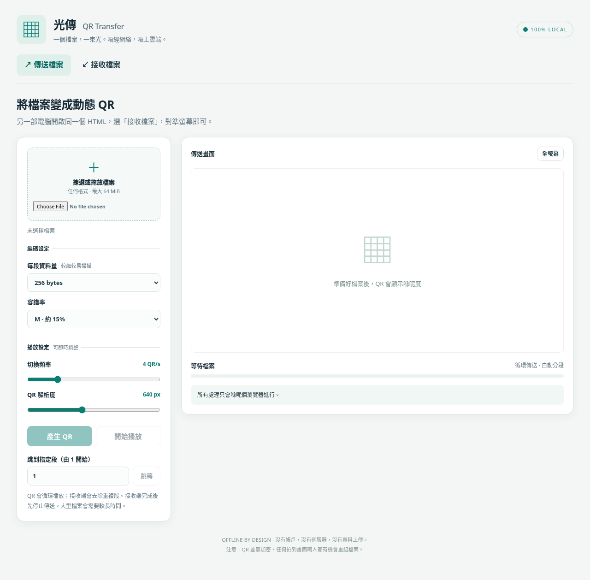
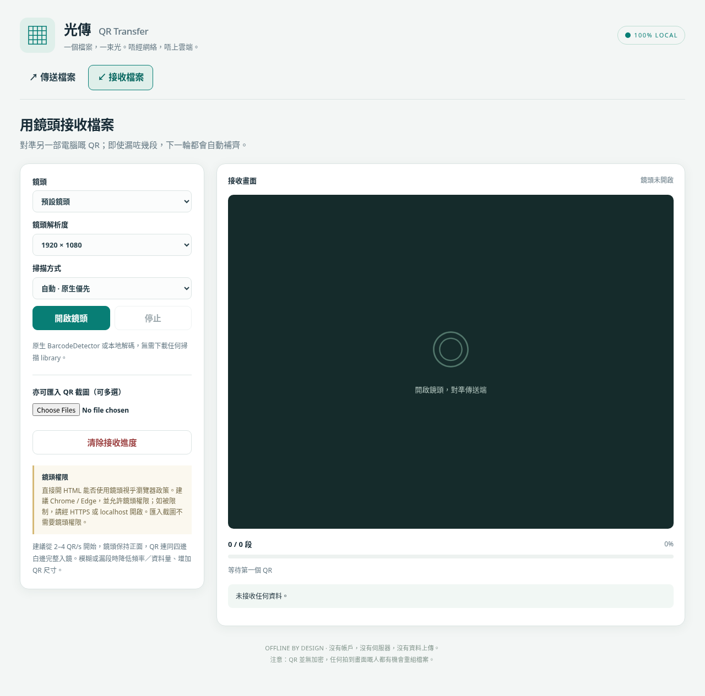

# 光傳 · Local QR Transfer

**▶ Try it now (no download needed): <https://ezrawong.github.io/local_qr_transfer/dist/>**
**▶ 即開即用（無需下載）：<https://ezrawong.github.io/local_qr_transfer/dist/>**

## Screenshots

| Send file · 傳送檔案 | Receive file · 接收檔案 |
| :---: | :---: |
|  |  |

## English

Transfer a file between two computers using a sequence of QR codes. The app runs entirely in the browser: there is no backend, account, network connection, or CDN required for the transfer.

### Features

- Split a file into numbered QR-code packets and repeatedly cycle through them for visual transfer.
- Receive packets with a camera or by importing one or more QR-code screenshots. Packets may arrive out of order; duplicates are ignored, and missing packets are reported.
- Join a transfer partway through. Each packet includes the transfer metadata needed by the receiver.
- Check each packet with CRC-32 and verify the completed file with SHA-256 before enabling the download.
- Adjust packet size, QR error correction, display refresh rate, QR canvas resolution, and camera resolution.
- Use the browser's native `BarcodeDetector` when available, or the bundled local QR decoder. No scanning library or image is downloaded or uploaded.
- Build a single self-contained HTML file with all required JavaScript and CSS embedded.

### Requirements and dependencies

- **To build:** Node.js 20 or later and npm.
- **Direct npm dependency:** [`qrcode`](https://www.npmjs.com/package/qrcode) 1.5.4, used to generate QR codes. The build bundles only the required modules; its string-optimization helper is supplied by local project code.
- **At runtime:** A modern browser such as Chrome or Edge. Node.js and `node_modules` are not needed on the computers using the built HTML.
- No bundler such as webpack or Vite is used. The build script uses Node.js built-in modules.

### Build and run

From the project directory, install dependencies and build:

```powershell
npm.cmd ci
npm.cmd run build
```

The build output is **`dist/index.html`**. Copy that file to both computers and open it in a browser. The HTML is self-contained; you do not need to copy `node_modules` or install Node.js on either computer.

**Hosted version:** You can also skip building entirely and open the ready-to-use version at <https://ezrawong.github.io/local_qr_transfer/dist/> on both computers.

Camera access depends on browser security rules. Chrome and Edge usually allow camera access from `file://`, but this is not guaranteed by every system or organization. If the camera is unavailable, serve the file from a trusted HTTPS or localhost origin, or receive by importing QR screenshots. For example, with Python installed, run `python -m http.server 8000` from the project directory and open `http://localhost:8000/dist/` in the browser.

macOS / Linux users can run `npm ci` and `npm run build`.

### How to transfer a file

1. On the sending computer, choose **Send file**, select or drop a file, choose the encoding settings, then select **Generate QR**.
2. On the receiving computer, open the same HTML and choose **Receive file**. Allow camera access and aim at the full QR code, including its white margin. Alternatively, import QR-code screenshots.
3. Select **Start playback** on the sender. The receiver can start at any point; it collects packets across cycles and reports missing packet numbers. You can pause playback or manually jump to a requested packet.
4. When all packets have arrived, the receiver verifies the SHA-256 hash. Download becomes available only if verification succeeds. Keep the receiver page open until the download is complete.

The transfer is visual and one-way: the sender cannot automatically tell whether the receiver has finished.

### Settings

| Setting | Range / behavior |
|---|---|
| Data bytes per packet | 64–1024 bytes; default 256. Smaller packets make less dense QR codes. |
| QR error correction | L / M / Q / H. Higher correction can make QR codes denser. |
| Playback frequency | 1–15 QR codes per second; adjustable during playback. Start with 2–4. |
| QR canvas resolution | 256–1200 px; adjustable during playback. Rendering uses whole-pixel modules and preserves a white margin. |
| Camera resolution | 640×480, 1280×720, or 1920×1080; the browser will try to match the selection. |
| Decoder | Native-first, local decoder, or native-only. |

Changing packet size or error correction requires generating the QR sequence again. This creates a new transfer ID, so the receiver must clear its previous progress. Large packets combined with high error correction may exceed QR capacity; reduce the packet size or shorten the filename if prompted.

### Compatibility and camera notes

- The native scanner is preferred when the browser provides QR support through `BarcodeDetector`; otherwise the app uses its bundled decoder.
- Camera access generally requires a secure browser context, such as HTTPS or localhost. Directly opening the HTML may work in Chrome or Edge, but is not guaranteed.
- The local decoder supports standard QR byte, numeric, and alphanumeric content and Reed–Solomon error correction. Real-world scanning depends on lighting, focus, screen glare, QR density, and angle. Keep the full white margin visible and aim the camera nearly straight at the code. Native scanning may work better with camera images.
- Avoid displaying the QR code too small. The canvas resolution is its internal pixel size; the code scales to fit the available screen. Full-screen display can help.

### Protocol, limits, and security

Each QR packet contains the `QRT1` version marker, a random 96-bit transfer ID, file metadata, SHA-256, packet index, base64url-encoded data, and CRC-32. Metadata is repeated so a receiver can join mid-transfer, at the cost of QR capacity. Packets are checked individually, and the complete file is hash-verified. Packets from different transfers are not combined.

- One file at a time; maximum file size is **64 MiB**.
- File data and received packets stay in memory. Refreshing or closing the page loses progress; there is no persistent storage or cross-page resume.
- At the default 256 bytes per packet and 4 QR codes per second, the theoretical raw data rate is about **1 KiB/s**. Actual speed is lower when packets are missed. A 1 MiB file takes at least about 17 minutes, so this is best for text and small documents or configuration files, not large videos.
- Playback frequency is a target maximum. Encoding time, camera frame rate, CPU load, and background-tab throttling can reduce the actual rate. Playback pauses while the sender tab is hidden and resumes when visible.
- CRC-32 and SHA-256 verify data integrity; they do **not** provide encryption, sender authentication, or protection against deliberate tampering. Anyone who captures the QR codes may be able to reconstruct the file. Only download or open files from trusted sources.

### Development

Run the tests and build:

```powershell
npm.cmd test
npm.cmd run build
```

`src/app.js` handles the interface, camera, playback, and download. `src/protocol.js` handles packetization, validation, and reassembly. `src/qr-decoder.js` is the local QR decoder. `scripts/build.js` bundles the required modules, styles, and page into one HTML file and includes the `qrcode` MIT license text.

### License

This project is licensed under the [MIT License](LICENSE). The bundled `qrcode` dependency is also MIT licensed, and its license text is included in the built HTML.

## 繁體中文

透過連續 QR code 將檔案由一部電腦傳送到另一部。應用程式完全在瀏覽器內運行；傳輸不需要後端、帳戶、網絡連線或 CDN。

### 功能

- 將檔案分成有編號的 QR code 封包，並循環播放，進行視覺傳輸。
- 可用鏡頭接收封包，亦可匯入一張或多張 QR code 截圖。封包可以亂序接收；重複封包會忽略，並會提示尚欠封包。
- 可在傳輸中途加入接收；每個封包都包含接收端所需的傳輸資料。
- 每個封包均以 CRC-32 檢查，完整檔案亦會以 SHA-256 驗證；驗證成功後才會啟用下載。
- 可調整每段資料量、QR 容錯率、畫面切換頻率、QR 畫布解析度及鏡頭解析度。
- 優先使用瀏覽器原生 `BarcodeDetector`（如有支援），否則使用內置的本地 QR 解碼器。掃描不會下載任何 library，亦不會上載影像。
- 可建置成單一、內嵌所需 JavaScript 及 CSS 的 HTML 檔案。

### 需求及依賴

- **建置需求：** Node.js 20 或以上及 npm。
- **直接 npm 依賴：** [`qrcode`](https://www.npmjs.com/package/qrcode) 1.5.4，用於產生 QR code。建置時只會打包所需模組；字串最佳化 helper 使用專案內的程式碼。
- **執行需求：** Chrome 或 Edge 等現代瀏覽器。使用建置後 HTML 的電腦不需要 Node.js 或 `node_modules`。
- 不使用 webpack 或 Vite 等打包工具；建置指令使用 Node.js 內置模組。

### 建置及執行

在專案目錄執行以下指令，安裝依賴並建置：

```powershell
npm.cmd ci
npm.cmd run build
```

建置產物是 **`dist/index.html`**。將此檔案複製到兩部電腦，並用瀏覽器開啟。HTML 已包含所需內容，不必複製 `node_modules`，使用端亦毋須安裝 Node.js。

**線上版本：** 亦可完全略過建置，直接在兩部電腦開啟即用版本：<https://ezrawong.github.io/local_qr_transfer/dist/>

鏡頭存取受瀏覽器安全政策限制。Chrome 和 Edge 通常允許從 `file://` 開啟鏡頭，但不同系統或機構政策未必一樣。若無法使用鏡頭，請從可信的 HTTPS 或 localhost 網址開啟，或改為匯入 QR 截圖接收。例如，若已安裝 Python，可在專案目錄執行 `python -m http.server 8000`，然後用瀏覽器開啟 `http://localhost:8000/dist/`。

macOS / Linux 使用者可執行 `npm ci` 及 `npm run build`。

### 傳輸步驟

1. 在傳送端選擇 **傳送檔案**，選取或拖入檔案，設定編碼選項，再按 **產生 QR**。
2. 在接收端開啟相同 HTML，選擇 **接收檔案**。允許使用鏡頭，並對準完整 QR code（包括四邊白邊）；亦可匯入 QR code 截圖。
3. 在傳送端按 **開始播放**。接收端可在任何時候開始接收，會在循環播放期間收集封包並提示欠缺的封包編號。可暫停播放，或手動跳到指定封包。
4. 收齊封包後，接收端會驗證 SHA-256。只有驗證成功才可下載。下載完成前請保持接收頁面開啟。

傳輸只透過視覺方式單向進行；傳送端無法自動得知接收端是否已完成。

### 設定

| 設定 | 範圍／行為 |
|---|---|
| 每段資料量 | 64–1024 bytes，預設 256。減少資料量可降低 QR 密度。 |
| QR 容錯率 | L / M / Q / H。較高容錯率可能令 QR 更密。 |
| 播放頻率 | 每秒 1–15 個 QR；播放期間可調整。初次建議 2–4。 |
| QR 畫布解析度 | 256–1200 px；播放期間可調整。以整數像素繪製並保留白邊。 |
| 鏡頭解析度 | 640×480、1280×720 或 1920×1080；瀏覽器會盡量配合。 |
| 解碼方式 | 原生優先、本地解碼器或只用原生解碼。 |

更改每段資料量或容錯率後，必須重新產生 QR 序列。這會建立新的傳輸 ID，因此接收端亦須清除舊進度。大段資料配合高容錯率可能超出 QR 容量；如介面提示，請減少每段資料量或縮短檔名。

### 相容性及鏡頭注意事項

- 若瀏覽器的 `BarcodeDetector` 支援 QR，會優先使用原生掃描；否則使用應用程式內置的解碼器。
- 鏡頭通常需要安全的瀏覽器環境，例如 HTTPS 或 localhost。Chrome 或 Edge 直接開啟 HTML 可能可用，但無法保證所有環境都支援。
- 本地解碼器支援標準 QR byte、numeric、alphanumeric 內容及 Reed–Solomon 容錯。實際掃描效果受光線、對焦、螢幕反光、QR 密度及角度影響。請保留完整白邊，並盡量正面對準 QR。使用鏡頭拍攝時，原生掃描可能有較佳效果。
- 避免將 QR 顯示得太細。畫布解析度是內部像素尺寸，畫面會按可用空間縮放；使用全螢幕可能有幫助。

### 協定、限制及安全

每個 QR 封包包含 `QRT1` 版本標記、隨機 96-bit 傳輸 ID、檔案資料、SHA-256、封包編號、base64url 編碼資料及 CRC-32。重複資料令接收端可以中途加入，但會佔用 QR 容量。封包會逐一檢查，完整檔案亦會驗證 hash；不同傳輸的封包不會混合。

- 一次只處理一個檔案；檔案上限為 **64 MiB**。
- 檔案及已接收封包只保存在記憶體。重新整理或關閉頁面會遺失進度；沒有持久化儲存或跨頁面續傳。
- 使用預設每段 256 bytes、每秒 4 個 QR 時，理論原始資料速度約為 **1 KiB/s**。漏讀封包會令實際速度更慢。1 MiB 檔案至少約需 17 分鐘，因此較適合文字、小型文件或設定檔，不適合大型影片。
- 播放頻率是目標上限；編碼時間、鏡頭幀率、CPU 負載及背景分頁節流都可能降低實際速度。傳送頁面隱藏時會暫停播放，返回後繼續。
- CRC-32 及 SHA-256 只驗證資料完整性，**不提供加密、傳送者認證或防止蓄意竄改的保證**。拍攝到 QR code 的人可能重組檔案。只下載或開啟可信來源的檔案。

### 開發

執行測試及建置：

```powershell
npm.cmd test
npm.cmd run build
```

`src/app.js` 負責介面、鏡頭、播放及下載；`src/protocol.js` 負責分段、驗證及重組；`src/qr-decoder.js` 是本地 QR 解碼器。`scripts/build.js` 會將所需模組、樣式及頁面包成單一 HTML，並附上 `qrcode` 的 MIT 授權文字。

### 授權

本專案採用 [MIT 授權條款](LICENSE)。所依賴的 `qrcode` 套件同樣為 MIT 授權，其授權文字已包含在建置後的 HTML 內。
